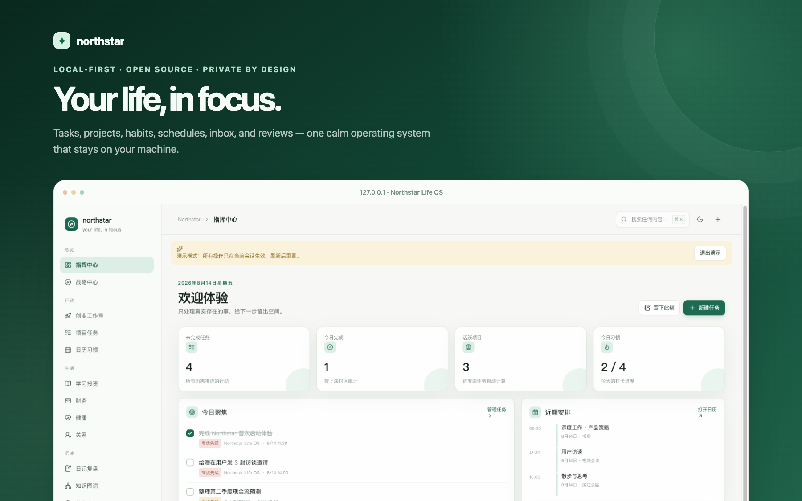
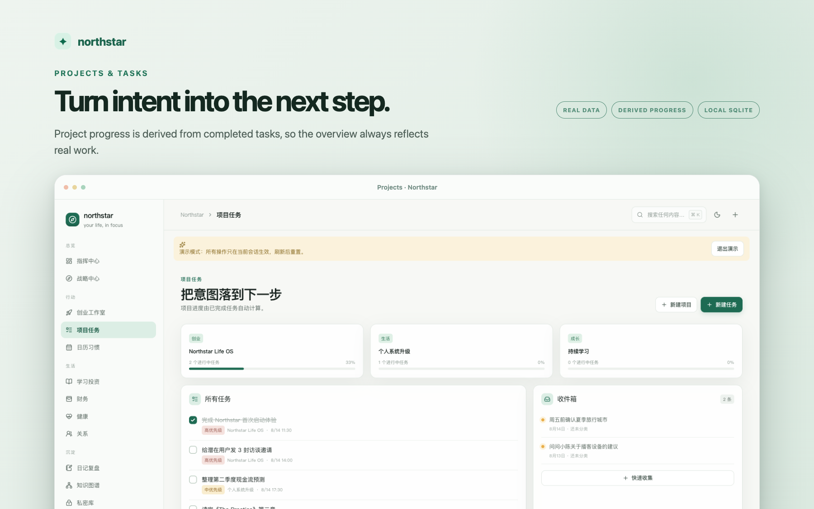
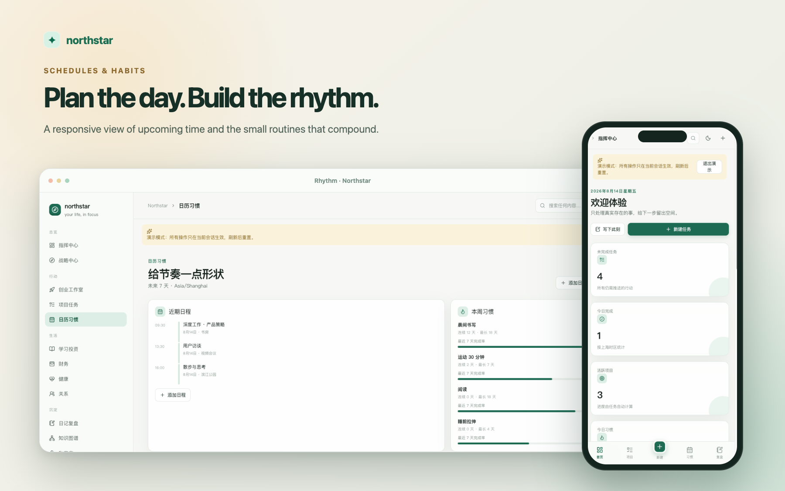
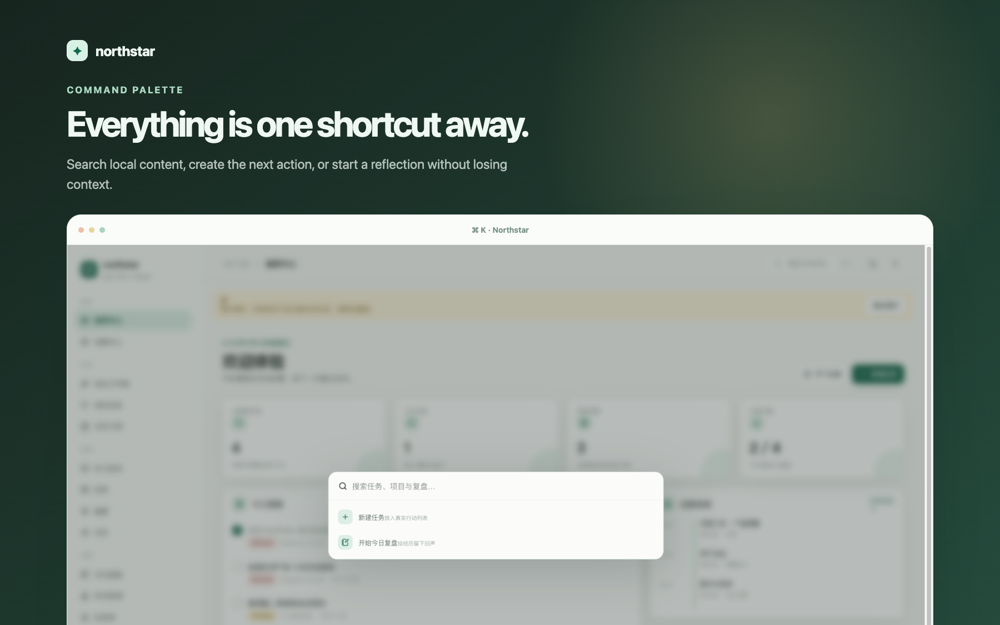

# Northstar Life OS

[](https://github.com/larrynode/northstar-life-os/actions/workflows/ci.yml)
[](LICENSE)
[](https://nodejs.org/)

[English](README.md) · [架构](docs/ARCHITECTURE.md) · [隐私模型](docs/PRIVACY.md) · [参与贡献](CONTRIBUTING.md) · [维护指南](docs/MAINTAINERS.md)

Northstar 是一个本地优先的个人操作系统，用于管理项目、任务、习惯、
日程、收件箱和复盘，并为自动化提供可审阅的安全边界。它由仅限本机访问
的 Dashboard、版本化 CLI 和浏览器加密私密库组成。

Northstar 不要求账户、遥测、云同步或外部 AI API。Dashboard 只监听
`127.0.0.1:18766`；CLI 是脚本和 Codex 自动化唯一受支持的数据边界。



_截图使用不会持久化的演示模式生成，不包含个人数据库内容。_

> **项目状态：** `v0.1.0` 是早期公开版本。项目、任务、习惯、日程、
> 收件箱和复盘已经形成真实数据闭环；战略、学习、财务、健康、关系和
> 知识图谱仍是扩展入口。真实模式不会用演示数字冒充个人数据。

## 快速开始

需要 Node.js 24 和 pnpm 10 或更高版本。

```sh
git clone https://github.com/larrynode/northstar-life-os.git
cd northstar-life-os
corepack enable
pnpm install --frozen-lockfile
pnpm build:cli
pnpm dev
```

打开 <http://127.0.0.1:18766>。不要把服务绑定到局域网或公网；Northstar
不是多用户或面向互联网部署的应用。

首次打开时，真实数据库为空是正常的。系统会显示创建入口，而不是自动
混入演示数据。设置中的演示模式是浏览器会话沙盒，刷新后重置，也不会
访问真实导入、导出或私密库。

## 核心能力

- 创建并持久化项目、任务、习惯打卡、日程、收件箱和复盘。
- 根据任务完成情况派生项目进度。
- 提供日、周、月安全复盘投影。
- 提供版本化 JSON CLI 和草稿审批工作流。
- 支持 JSON/CSV/ICS 导入导出，其中导入先预览、去重，再事务应用。
- 支持带清单和哈希校验的完整备份；恢复必须显式确认。
- 私密条目在浏览器中加密，普通搜索、导出和 CLI 上下文永远不包含私密库。
- 提供每日计划、收件箱整理、日/周复盘和项目健康检查等 Codex Skills。

## 产品一览

### 让项目进展来自真实行动



### 安排今天，建立长期节奏



### 不离开当前上下文，也能快速搜索和行动



## 数据与隐私边界

默认数据目录位于：

```text
~/Library/Application Support/NorthstarLifeOS/
├── db/northstar.sqlite
├── attachments/
└── backups/
```

测试时可用 `NORTHSTAR_DATA_DIR` 指向一次性目录。不得把数据库、附件、
导出、备份、日志、密钥或私人记录提交到 Git。

自动化只能通过以下安全 CLI 投影读取数据：

```sh
pnpm northstar doctor --json
pnpm northstar context today --json
pnpm northstar context week --json
pnpm northstar list task --status active --json
pnpm northstar review daily --json
pnpm northstar review weekly --json
```

代理生成的计划、整理和推断修改必须先创建草稿，由人确认后才能批准并应用。

```sh
pnpm northstar draft create daily_plan \
  --title "Daily plan" \
  --data '{"priorities":[],"source_ids":[]}' \
  --json
pnpm northstar draft list --json
pnpm northstar draft show <draft-id> --json
pnpm northstar draft approve <draft-id> --json
pnpm northstar draft apply <draft-id> --json
```

## 开发验证

```sh
pnpm check:public
pnpm typecheck
pnpm lint
pnpm test
pnpm test:e2e
pnpm build
```

Playwright 使用 `/private/tmp` 中的隔离数据和专用测试端口，不会复用或
中断正式 Dashboard。

## 安全限制

Northstar 把本地操作系统账户和文件权限视为主要信任边界，不能防御 root
访问、恶意软件、屏幕录制或已被攻破的系统账户。私密库口令不会被保存，
忘记后系统无法找回或重置。

漏洞请通过 [GitHub 私密安全报告](https://github.com/larrynode/northstar-life-os/security/advisories/new)
提交，不要在公开 Issue 中提供真实记录、数据库、日志或口令。

## 开源协议与贡献

项目采用 [MIT License](LICENSE)。欢迎提交范围清晰的 Issue 和 Pull Request。
参与前请阅读 [CONTRIBUTING.md](CONTRIBUTING.md)、[SECURITY.md](SECURITY.md)
和 [CODE_OF_CONDUCT.md](CODE_OF_CONDUCT.md)。所有公开复现必须使用合成数据。
